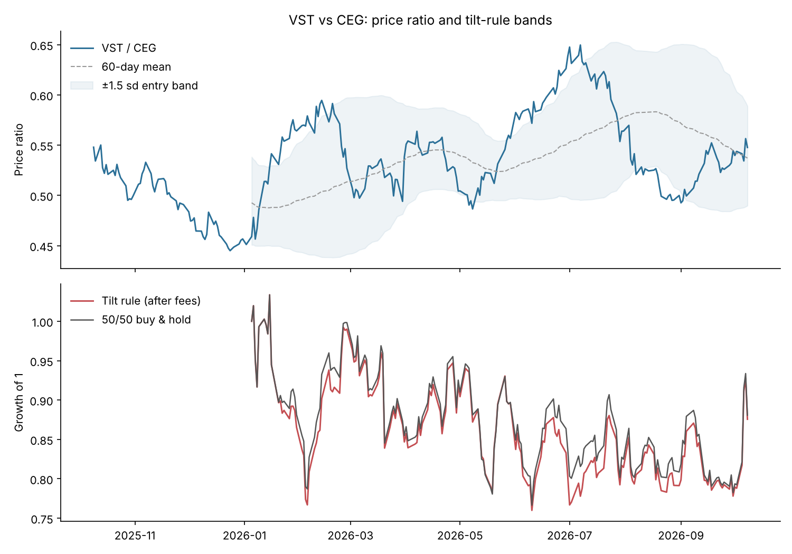

# Backtest 001: Long-only pairs tilt, VST vs CEG

**Date:** 9 Oct 2026 · **Data:** daily closes, 9 Oct 2025 → 8 Oct 2026 (251 trading days) · **Code:** [`pairs_vst_ceg.py`](pairs_vst_ceg.py)

## The question
Vistra (VST) and Constellation (CEG) both sell firm nuclear power into the AI data-centre boom. I hold both. When one runs ahead of the other, does tilting toward the laggard beat just holding 50/50?

This is a **long-only** version of a pairs trade. Classic stat arb shorts the leader, which I can't do in an ISA, so the rule only decides which of two holdings gets more weight.

## Is it even a pair?

| Check | Result |
|---|---|
| 1-year change | VST **−25.6%**, CEG **−25.6%** (identical) |
| Daily return correlation | **0.81** |
| VST/CEG ratio | 0.548 today · mean 0.535 · range 0.445 (24 Dec 2025) to 0.650 (7 Jul 2026) |
| Where it sits now | z = **+0.34** vs the full year, **+0.32** vs the last 60 days. **No signal.** |
| Mean-reversion half-life | ~**25 trading days** |

So yes, they behave like a pair: they move together and gaps tend to close within about a month.

## The rule
- Signal: z-score of log(VST/CEG) vs its rolling 60-day mean.
- z > +1.5 (VST rich) → hold 25% VST / 75% CEG.
- z < −1.5 (VST cheap) → hold 75% VST / 25% CEG.
- |z| < 0.5 → back to 50/50. In between, keep the current tilt.
- Signal from day *t*'s close, traded at day *t+1*'s close (no look-ahead).
- 0.15% fee per side on everything traded (my broker's FX fee).

## Results

| | Return | Max drawdown |
|---|---|---|
| Tilt rule (after fees) | −12.4% | −26.5% |
| 50/50 buy & hold | −11.9% | −25.8% |
| **Edge** | **−0.5 pts** | |

8 rebalances, 96 of 192 test days spent tilted.



### Sensitivity (edge vs 50/50, percentage points)

| Window | entry 1.0 | entry 1.5 | entry 2.0 |
|---|---|---|---|
| 40 days | −2.0 | −1.0 | −2.0 |
| 60 days | +0.4 | −0.5 | +2.0 |
| 90 days | +6.0 | +6.2 | +1.0 |

## What broke, and what I learned
1. **The default rule didn't beat doing nothing.** After fees it was slightly worse. A relationship that "obviously" mean-reverts on a chart doesn't automatically become a profitable rule.
2. **The rule fights trends.** From January to July the ratio drifted upward, so the rule kept betting against VST while VST kept outperforming. The rolling mean lags, so the bands keep chasing the price.
3. **The one clean win was the July spike.** The ratio hit 0.650, the rule tilted to CEG, and the gap closed by August. That one episode is most of what the rule is good for.
4. **The 90-day result (+6%) is the trap.** It looks great, but it's one year of data and a handful of trades. Picking the best cell of a sensitivity table *after* seeing results is overfitting. I won't trade it until it holds up on data it wasn't tuned on.

## How I'm using it
Not as an automatic strategy. As a **tie-breaker for new money** into my nuclear sleeve: if the ratio is stretched (roughly above 0.62 or below 0.48), new cash goes to the laggard. Otherwise it's split as normal.

## Next steps
- [ ] Re-test on 3–5 years of data (needs a longer data source).
- [ ] Walk-forward test: tune on year 1, test on year 2.
- [ ] Try the same rule on NVDA/TSM.
- [ ] Track the live "tie-breaker" decisions in the weekly reviews and compare in 6 months.

## Run it yourself
```bash
pip install -r requirements.txt
python backtests/pairs_vst_ceg.py
```
